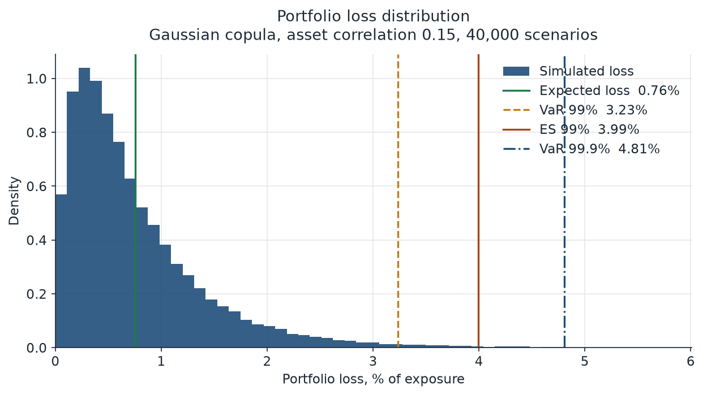
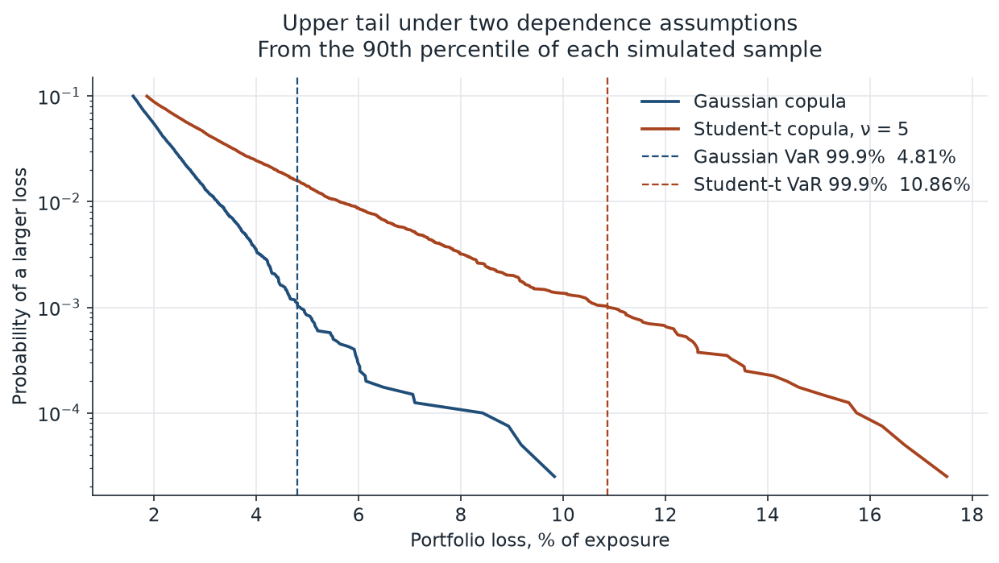
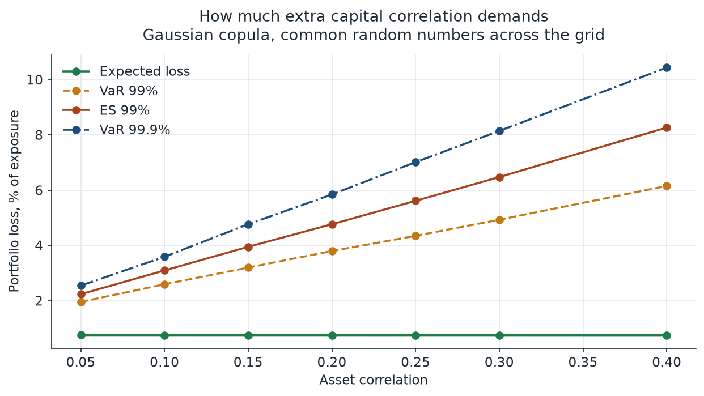
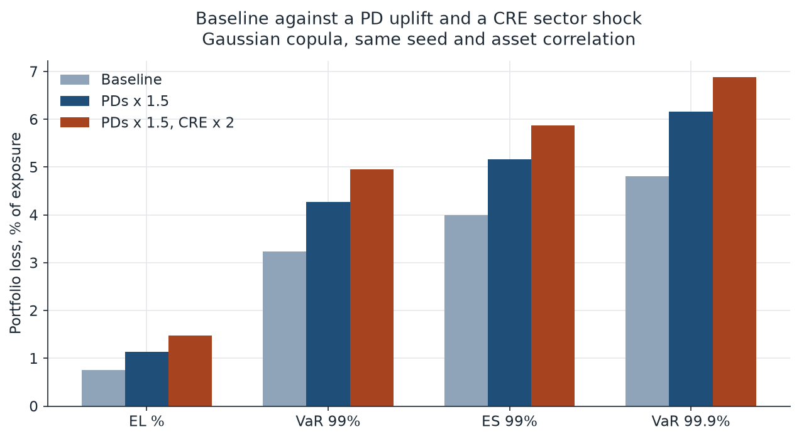
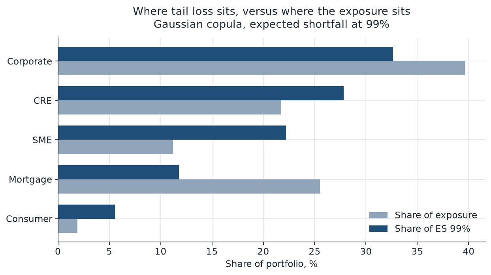

# Credit Portfolio Loss Simulation

**Santiago Diaz Ricagno, Lead Data Scientist**

How much capital does a lender need against portfolio credit losses, and how much does the dependence assumption matter? This study answers that on a synthetic book of 2,500 loans. Expected loss is the sum of PD × LGD × exposure, and it does not depend on how defaults move together. Capital does. The same loans are run through a one-factor Gaussian copula, the Vasicek model behind the large-portfolio limit, and through a Student-t copula that adds a shared chi-square shock. The mean loss is the same under both copulas. Under these parameters the heavier tail more than doubles the 99.9% capital number.

## Method

Each loan is assigned a sector, a rating, a probability of default, a loss given default, and an exposure at default. Sectors are Mortgage, Consumer, SME, Corporate, and CRE. Ratings map to a fixed one-year PD:

| Rating | PD |
| --- | ---: |
| AAA | 0.02% |
| AA | 0.05% |
| A | 0.08% |
| BBB | 0.25% |
| BB | 1.20% |
| B | 4.50% |
| CCC | 15.0% |

That map is illustrative. LGD is drawn once per loan from a Beta distribution centered on the sector mean (about 22% for mortgages, about 55% for consumer, with the other sectors in between) and then held fixed. Exposure is drawn from a lognormal distribution. The generator is seeded, so the book is reproducible.

Defaults are driven by a single systematic factor. For the Gaussian copula the latent asset of loan `i` is

```text
A_i = sqrt(ρ) * Z + sqrt(1 − ρ) * ε_i
```

with `Z` and `ε_i` independent standard normals. The loan defaults when `A_i` falls below the standard-normal quantile of its PD. A low draw of `Z` is a weak economy and lifts every conditional PD together. The published runs use an asset correlation of 0.15.

The Student-t variant divides that same one-factor Gaussian by a shared shock:

```text
X_i = sqrt(ν / W) * A_i,    W ~ chi-square(ν)
```

and defaults when `X_i` falls below the Student-t quantile of its PD. Here ν = 5. Because the threshold is the marginal quantile of `X_i`, each loan still defaults with probability `PD_i`. The two models share a mean and differ in the tail.

Portfolio loss on a scenario is the sum of exposure × LGD over the loans that default. Value at Risk at level α is the empirical quantile of that loss. Expected shortfall is the mean of the scenarios at or above that quantile, so ES is at least VaR. Reported figures are a share of total exposure. The run uses 40,000 scenarios.

Two closed-form checks sit next to the simulation. Analytic expected loss is the sum of PD × LGD × EAD. The Vasicek large-portfolio quantile replaces each default indicator with the conditional PD at the stressed factor `Z = −Φ⁻¹(α)`:

```text
L_α = Σ EAD_i * LGD_i * Φ( (Φ^{-1}(PD_i) + sqrt(ρ) * Φ^{-1}(α)) / sqrt(1 − ρ) )
```

That expression is the loss of an infinitely fine book. A companion simulation drops the idiosyncratic draws and keeps only the systematic factor, which should land on the same number. Vasicek expected shortfall integrates that quantile from α to 1.

Sector contributions to ES are the average of each sector's loss inside the tail scenarios. They add up to portfolio ES. The correlation grid resimulates the Gaussian model on ρ from 0.05 to 0.40 with common random numbers (30,000 scenarios). The stress keeps ρ = 0.15 and the same seed, multiplies every PD by 1.5, then multiplies CRE PDs by a further 2.

## Results

The seeded book has **$483.8 million** of exposure. The largest loan is 0.67% of the book, and the exposure Herfindahl implies about 743 equal loans. Analytic expected loss is **$3.66 million**, or **0.76%** of exposure.

| Sector | Loans | Exposure | Exposure share | EAD-weighted PD | EAD-weighted LGD | EL rate | EL share |
| --- | ---: | ---: | ---: | ---: | ---: | ---: | ---: |
| Mortgage | 726 | $123.4m | 25.5% | 1.38% | 22.0% | 0.31% | 10.5% |
| Consumer | 674 | $9.3m | 1.9% | 4.74% | 54.8% | 2.63% | 6.6% |
| SME | 585 | $54.2m | 11.2% | 3.91% | 42.4% | 1.67% | 24.7% |
| Corporate | 316 | $191.8m | 39.6% | 1.38% | 37.8% | 0.53% | 27.8% |
| CRE | 199 | $105.2m | 21.7% | 3.49% | 30.2% | 1.05% | 30.3% |

Capital below is the loss quantile (and the mean beyond it), in percent of exposure. Unexpected loss is that quantile minus expected loss.

| Model | EL | VaR 95% | ES 95% | VaR 99% | ES 99% | VaR 99.9% | ES 99.9% |
| --- | ---: | ---: | ---: | ---: | ---: | ---: | ---: |
| Vasicek large-portfolio limit | 0.756 | 2.02 | 2.71 | 3.13 | 3.87 | 4.85 | 5.64 |
| Gaussian, factor only | 0.755 | 2.02 | 2.71 | 3.15 | 3.86 | 4.83 | 5.63 |
| Gaussian copula | 0.756 | 2.05 | 2.78 | 3.23 | 3.99 | 4.81 | 5.89 |
| Student-t copula (ν = 5) | 0.755 | 2.83 | 4.61 | 5.63 | 7.78 | 10.86 | 12.85 |

On this book the Gaussian 99.9% loss is **$23.3 million** (unexpected loss **$19.6 million**). The Student-t 99.9% loss is **$52.6 million** (unexpected loss **$48.9 million**). Expected shortfall at 99.9% is $28.5 million under the Gaussian copula and $62.2 million under the Student-t copula. Same loans, same PDs, same correlation: the dependence model is the difference.

Simulated expected loss matches the analytic sum. The Gaussian mean is 0.008% above the sum of PD × LGD × EAD. The Student-t mean is 0.10% below it. The factor-only 99.9% quantile is 4.83% of exposure against a Vasicek limit of 4.85% (about 0.4% relative). The full Gaussian simulation sits in the same place, which is what a book this diversified should do. At 99.9% the ordering versus the limit moves by a few basis points across runs of the quantile; that cutoff has about 40 scenarios beyond it in a sample of 40,000. Expected shortfall, which averages the tail, sits above the Vasicek shortfall at every level reported here.



The Gaussian loss distribution is skewed right. Expected loss at 0.76% of exposure sits in the body of the histogram. The 99% loss is 3.23%, and the 99.9% loss is 4.81%. The histogram is drawn out to 1.25 times that 99.9% loss so the tail marks stay on the chart.



From the 90th percentile upward the Student-t curve decays more slowly. At a 0.1% probability of a worse outcome, the Student-t loss is 10.86% of exposure and the Gaussian loss is 4.81%.



| Asset correlation | EL | VaR 99% | ES 99% | VaR 99.9% |
| --- | ---: | ---: | ---: | ---: |
| 0.05 | 0.753 | 1.95 | 2.23 | 2.54 |
| 0.10 | 0.752 | 2.59 | 3.09 | 3.59 |
| 0.15 | 0.752 | 3.20 | 3.95 | 4.76 |
| 0.20 | 0.752 | 3.80 | 4.77 | 5.84 |
| 0.25 | 0.751 | 4.35 | 5.61 | 7.01 |
| 0.30 | 0.751 | 4.93 | 6.47 | 8.14 |
| 0.40 | 0.750 | 6.15 | 8.26 | 10.43 |

Raising asset correlation from 0.05 to 0.40 lifts the Gaussian 99.9% loss from 2.54% of exposure to 10.43%. Expected loss stays near 0.75% the whole way. This grid is a separate 30,000-scenario sample with shared draws across ρ, so the row at 0.15 is a nearby estimate from a different sample than the headline Gaussian column. Analytic expected loss does not depend on ρ. The 0.003 point drift in the simulated mean is sampling error.



| Scenario | EL | VaR 99% | ES 99% | VaR 99.9% | ES 99.9% |
| --- | ---: | ---: | ---: | ---: | ---: |
| Baseline | 0.756 | 3.23 | 3.99 | 4.81 | 5.89 |
| PDs × 1.5 | 1.134 | 4.27 | 5.16 | 6.16 | 7.36 |
| PDs × 1.5, then CRE × 2 | 1.477 | 4.95 | 5.87 | 6.88 | 8.18 |

Stress expected loss is the analytic sum, so the across-the-board PD uplift scales it by exactly 1.5. VaR and ES are resimulated at the same seed and the same correlation. The CRE leg then doubles CRE PDs again, which leaves CRE at three times its starting PD. The highest PD on the fully stressed book is 0.45, inside the 0.95 guard in the code. The 99.9% loss moves from 4.81% of exposure to 6.16% under the PD uplift and to 6.88% once CRE is shocked as well.



| Sector | Exposure share | EL share | ES 99% share |
| --- | ---: | ---: | ---: |
| Corporate | 39.6% | 27.8% | 32.6% |
| CRE | 21.7% | 30.3% | 27.8% |
| SME | 11.2% | 24.7% | 22.2% |
| Mortgage | 25.5% | 10.5% | 11.8% |
| Consumer | 1.9% | 6.6% | 5.6% |

SME is 11% of exposure and 22% of 99% expected shortfall. Mortgage is 26% of exposure and 12% of that tail. Consumer has the highest loss rate on the book, 2.63% of its own exposure, and a small balance, so it contributes 5.6% of tail loss. The ES shares add to 100% of portfolio ES.

The published run finished in about 16 seconds: 2,500 loans, 40,000 scenarios for the capital and stress comparisons, and 30,000 paired scenarios for the correlation grid.

## How to run

Requires Python 3.11 or newer.

```bash
python -m venv .venv
source .venv/bin/activate
pip install -r requirements.txt
python run_simulation.py
pytest
```

`python run_simulation.py` regenerates the five figures in `docs/` and prints the tables. The same entry point is `PYTHONPATH=src python -m credit_sim`. Optional flags: `--output` for the figure directory and `--results-json` for a machine-readable dump.

| Path | Role |
| --- | --- |
| `src/credit_sim/` | Portfolio generator, copulas, risk metrics, charts, runner |
| `run_simulation.py` | Script that reproduces the published figures |
| `tests/` | Seed, expected-loss, ES, correlation, and tail checks |
| `notebooks/credit_portfolio_loss.ipynb` | Walkthrough with executed outputs |
| `docs/` | Figures embedded above |

The notebook is already executed. Opening it does not require a new simulation. Running the cells again needs Jupyter, which is outside `requirements.txt`, and uses the same seeds as the script.

## Tech stack

| Component | Version |
| --- | --- |
| Python | 3.11+ (this run: 3.12.3) |
| numpy | 2.5.4 |
| scipy | 1.18.1 |
| pandas | 3.1.1 |
| matplotlib | 3.11.2 |
| pytest | 9.2.0 |
| ruff | 0.17.4 |

Pins live in `requirements.txt`. Line length is 110, set in `pyproject.toml`.

## Limitations

The book has one systematic factor. Sectors differ because their PDs, LGDs, and exposures differ. The CRE stress is a direct scaling of that sector's PDs, rather than a second factor.

LGD is a property of the loan, drawn at origination and held fixed in every scenario. Losses would be heavier in the tail if recoveries fell in the same scenarios as defaults.

The Student-t copula is a reduced-form description of joint defaults. ν = 5 is a modeling choice. A larger ν pulls the tail back toward the Gaussian result. The Gaussian copula has no tail dependence, so it is a thin-tailed benchmark.

A 99.9% quantile estimated from 40,000 scenarios has about 40 paths beyond the cutoff. Treat the last tenth of a percentage point as Monte Carlo noise, and prefer expected shortfall when comparing tails. The correlation grid is its own 30,000-path sample.

The rating map, Beta LGDs, lognormal exposures, and the single correlation are synthetic assumptions. They are not a rating-agency scale and not a portfolio of real borrowers.

The horizon is one year, and the outcome is default or survival. The loss does not include ratings migration, prepayment, fees, or mark-to-market spread risk.

The Vasicek column is the loss of an infinitely granular book. This portfolio is already close to that limit: the largest loan is 0.67% of exposure. A handful of very large names would leave a granularity gap that the closed form leaves out.

## License

Released under the MIT license. See [LICENSE](LICENSE).
